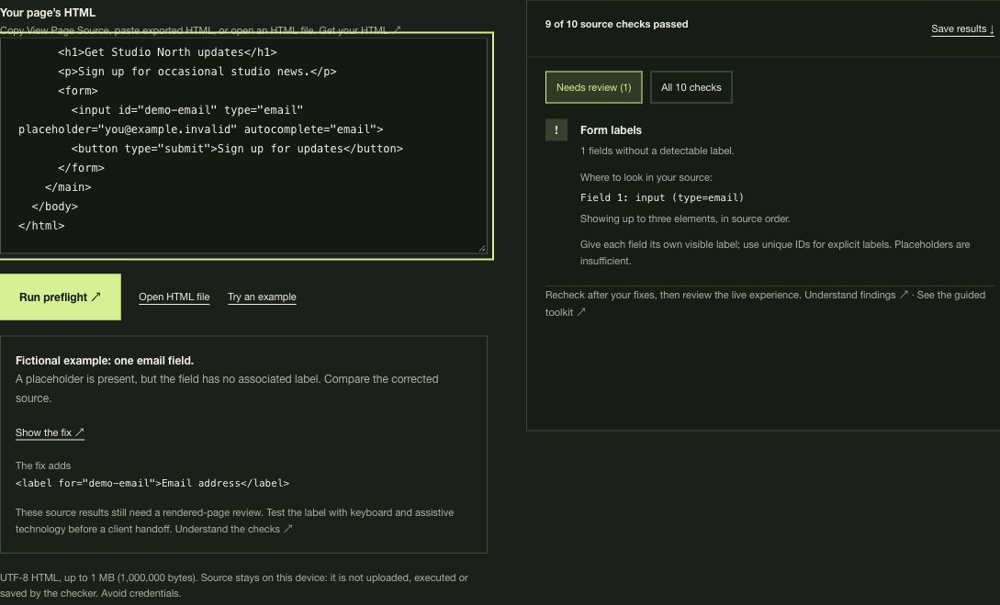

# LaunchCheck source preflight

Ten HTML source heuristics, run locally in your browser. Paste a page's HTML and get observations, source-location cues, and suggested next steps. The offline demo needs no account, API or dependencies, and sends no source or telemetry.

## Try it in your browser

[Open the free hosted checker](https://launch.7eventeen.dev/#preflight). No download or purchase is required; it runs the same ten source heuristics on your device.

The hosted site supports limited anonymous usage counts ([privacy details](https://launch.7eventeen.dev/privacy#usage)). You can also [open it with usage counts off](https://launch.7eventeen.dev/?measure=off#preflight).

## See a source finding



This fictional Studio North example shows the hosted free checker, with the input line visible beside its **Form labels** finding. The offline demo has a different layout and uses the same ten source heuristics. Choose **Show the fix** in the hosted example to compare the associated label. These are source observations, not a customer result or a rendered-page assessment.

## Try it offline

[Download the offline demo ZIP](https://github.com/7eventeendev/launchcheck-preflight/releases/download/v0.1.3/launchcheck-preflight-v0.1.3.zip), extract it, and open **demo.html** in your browser. The small package contains the free demo, a quickstart and the MIT license. No server or installation is needed; the demo does not save source or results.

For the source modules and development files, use **Code → Download ZIP** to download the full repository. The same self-contained **[demo.html](demo.html)** is included there.

Choose **Try fictional example** to inspect a Studio North email-signup page: 9 of 10 source checks pass, and the email input has no detectable label. **Show labeled version** adds a visible associated label and passes 10 of 10. These are fictional examples, not customer results. Editing the source clears stale observations until you check again.

## What it checks

| Source check | Expected markup |
| --- | --- |
| Page title | Non-empty `title` text |
| Search description | Non-empty description metadata |
| Document language | Non-empty `html` `lang` attribute |
| Mobile viewport | Complete `width=device-width` entries; conflicting widths need review |
| Main heading | One `h1` with text |
| Image text alternatives | An `alt` attribute on each image; empty is allowed |
| Form labels | A detectable HTML or ARIA name on each checked field |
| Button names | Detectable text, an ARIA name, or image alternative text |
| Canonical hint | A canonical relation token with a parseable absolute HTTP(S) URL |
| Social preview title | Non-empty Open Graph title metadata |

Viewport recognition is a source heuristic: it does not compute the effective viewport, resolve multiple viewport meta elements or test mobile layout/zoom.

These are heuristics, not conformance tests. A pass only means the expected source pattern was found. Empty image alt may be inappropriate, a language code may be wrong, a canonical may point to the wrong page, and detected names may still be confusing. The tool does not compute the full accessible-name algorithm or inspect rendered styles, JavaScript-generated content, keyboard use, contrast, performance, links, or security. Actual browser and human testing are still needed. No accessibility certification, ranking, conversion, or launch-readiness guarantee is provided.

## Use the browser API

Copy `src/` into your project and import the module from a page served by your development server:

```js
import {checkHtml, exampleHtml} from './src/index.mjs';

const findings = checkHtml(exampleHtml);
const labelFinding = findings.find(item => item.name === 'Form labels');
console.log(labelFinding.passed); // false for the fictional example
```

`checkHtml(string)` returns ten objects with `name`, `passed`, `detail`, `fix`, and `targets` fields. `targets` contains up to three ordinal element cues for relevant checks. Empty input, NUL characters, and input larger than 1,000,000 UTF-8 bytes are rejected. It requires a browser DOM; it is not a Node crawler or command-line website auditor.

`validateHtmlSource`, `MAX_HTML_BYTES`, and `readHtmlFile` are also exported. The optional file helper accepts `.html`/`.htm`, validates the size before and after reading, and requires valid UTF-8. The demo uses pasted text only.

Treat returned strings as untrusted source content. Render them with `textContent`, as the demo does, rather than inserting them as HTML. Keep `parseMarkup`'s template fragment inert; do not append pasted nodes into a live page.

## Privacy and development

The demo parses into an inert template. Pasted scripts and event handlers are not executed, resource elements are not attached to the live document, and findings are displayed as text. Its Content Security Policy blocks connections and external resources. The checker makes no network requests, uses no cookies or browser storage, and forgets input on reload. The optional footer website link requires internet access when you choose to follow it. Browser extensions and other code in an integrating application are outside this module's control; avoid credentials and private client data in examples or issue reports.

With Node.js 22 or later, no dependency installation is needed:

```sh
npm test
npm run build
```

The tests cover UTF-8 limits, file-input rejection, canonical URL syntax and complete viewport width entries. The build regenerates the committed self-contained `demo.html` from the shared source functions and fictional examples. Browser behavior should also be checked after engine changes.

## About

Maintained by **Ski / 7eventeen**. AI assistance was used to develop this software. This repository's source and demo are available under the [MIT license](LICENSE).

[LaunchCheck by 7eventeen](https://launch.7eventeen.dev/) includes a free hosted checker and an optional **US$39 one-time offline toolkit** with 45 guided manual checks, evidence notes, priorities, studio-branded printable reports, and JSON/CSV export. You perform the review yourself. The paid toolkit has separate terms and is not included in this repository; this repository's MIT license applies to these published files.
